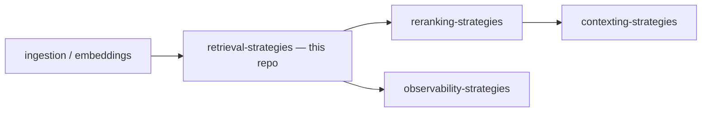

# Retrieval Strategies

**Reference implementation** for **RAG ingestion and retrieval** in multi-agent systems: chunking (fixed, recursive, semantic heuristic), search (dense, hybrid, metadata filter), and index layout (single shared index vs tenant partition simulation)—measured with **synthetic golden cases** (no live vector DB required for CI).

Maps to [AI-System-Architecturing-Engineering → retrieval](https://github.com/CaioHAndradeLima/AI-System-Architecturing-Engineering/tree/main/retrieval).

**Next stage in the stack:** after top-k retrieval, apply [reranking-strategies](https://github.com/CaioHAndradeLima/reranking-strategies) to reorder candidates before context assembly.

### Where retrieval runs



---

## Strategy comparison

Each named strategy fixes a **(chunking, search, storage)** triple:

| Strategy | Chunking | Search | Storage | Prefer when | Trade-off |
|----------|----------|--------|---------|-------------|-----------|
| `fixed_dense_single` | Fixed windows | Dense only | Single index | MVP, uniform docs | Mid-sentence cuts; weak on rare tokens |
| `recursive_hybrid_single` | Paragraph / sentence | BM25 + dense RRF | Single index | Default production RAG | More indexing work than fixed |
| `semantic_hybrid_tenant` | Sentence-sim heuristic | Hybrid | Tenant partition | Multi-tenant SaaS | Per-tenant index ops |
| `metadata_filter_partition` | Recursive | Metadata + BM25 | Tenant partition | Regulated / ACL-heavy | Filter errors drop recall |

**Default production baseline:** `recursive_hybrid_single`; add tenant partition + metadata filters before reranking when isolation matters.

---

## Quick start

```bash
python3 -m venv .venv && source .venv/bin/activate
pip install -e .
retrieval-lab evaluate
retrieval-lab evaluate-pipeline --profile ci-retrieval-eval
python -m unittest discover -s tests -v
```

See `docs/PIPELINE_EVAL.md` for CI profile fields.